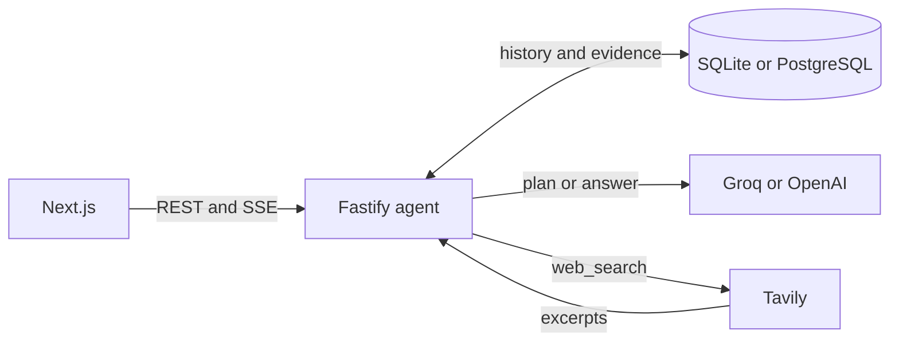

# Echo design

Echo is a time-aware chat agent. Its main question is “Does the answer you gave me before still hold?” A single `npm run dev` starts the Next.js workspace and the Fastify API on Node.js. The API handles routing, identity, evidence validation and persistence. Groq or OpenAI provides inference. Tavily backs the only agent tool, `web_search`.

**Routing and speed.** Rules send ordinary chat straight to one model call and answer exact-date recall from saved turns. Research uses a tool-planning call and a separate evidence extraction call. Independent queries run concurrently within a fixed budget. A short-lived cache saves Tavily calls on eligible repeats. Explicit rechecks bypass it and can reuse the earlier public query. The stream shows progress during inference and sends the validated reply after storage commits.

**Temporal memory.** Echo saves the original question, reply, citations and UTC timestamps. A separate research snapshot holds retrieved snippets, comparable claims and retrieval times. The browser timezone determines the date window for “3 November” and “last Tuesday.” A turn and its snapshots commit together. A request ID supports retries, and a revision check prevents concurrent turns from overwriting each other. Signed browser identities scope hosted histories.

**Evidence and uncertainty.** The model selects exact excerpts, which the API checks against Tavily results before assigning citation IDs. A change needs comparable claims from the same source page with fresh evidence. Pricing also needs the same tier, currency, billing interval and unit. Different versions of the same listing, conflicting values and missing history lead to qualified results. The Inspector exposes the search and memory path, citations and the earlier retrieval time.

**Tradeoffs.** I ruled out always searching because it adds a network call to simple turns. I also ruled out an open-ended tool loop so the server can enforce a small budget and check evidence before replying. SQLite keeps local setup to npm and an env file, while PostgreSQL supports hosted storage using the same tables. Exact excerpts and conservative matching can leave a real change unconfirmed when a source omits important details.

**With another week.** I’d add vendor-specific price normalization, stronger source ranking, and a labeled live evaluation set. I’d also index cross-session topic retrieval as histories grow.
