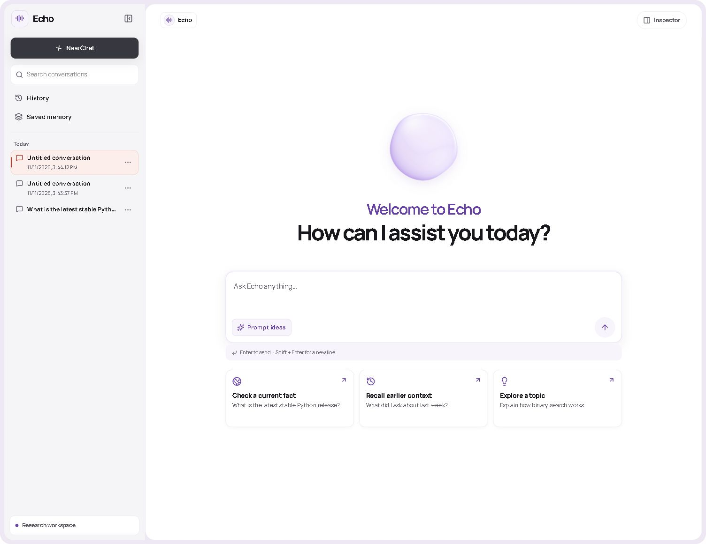

# Echo

**A time-aware AI chat agent with intelligent web search, persistent conversational memory, and evidence-backed change detection.**

Echo was built for the minimi engineering challenge. When a user asks whether an earlier answer still holds, Echo identifies the prior research, looks for fresh evidence, and compares the two observations. It keeps the dates and sources visible so the user can tell what was known then and what can be verified now.

*The running Echo app with a fixture conversation in the sidebar.*

[Live demo](https://echo-time-aware-agent.vercel.app/) · [Feature walkthrough and screenshots](docs/feature-walkthrough.md) · [Technical design](design.md) · [Verification and evaluation](VERIFICATION.md)

## What Echo does

- **Remembers conversations and explicit user details.** Conversations persist across restarts. Echo can recall a dated turn, retrieve a saved plan across conversations, and keep the previous value when a plan is corrected.
- **Searches when the question needs current evidence.** Rules route simple chat and personal recall away from search. For current questions, the model can call a single tool, `web_search`, backed by Tavily.
- **Compares evidence over time.** A recheck uses the original research snapshot as a baseline. Echo reports a change, agreement, conflict, or insufficient evidence according to what the retrieved excerpts support.
- **Shows its work in the Agent Inspector.** Inspect any saved answer to see search and memory usage, timings, trace ID, source excerpts, retrieval dates, and previous and current evidence. The Saved memory tab shows active and superseded records.

## Architecture

~~~mermaid
flowchart LR
    B[Browser] --> N[Next.js chat workspace]
    N -->|Same-origin REST and SSE| A[FastAPI]
    A --> R[Routing and context]
    R -->|Read history, memory and snapshots| D[(PostgreSQL or local SQLite)]
    R -->|Plan search or generate answer| M[Groq or OpenAI]
    R -->|One web search tool| T[Tavily]
    T --> G[Validate excerpts and compare claims]
    M --> G
    G -->|Commit turn, memory and research| D
    G -->|Progress and saved reply| A
~~~

The frontend uses Next.js, React, TypeScript, and CSS. The backend uses Python, FastAPI, Pydantic, SQLAlchemy, and Alembic. Groq hosts the default model in the example configuration. The same adapter supports OpenAI.

1. **Load context.** Echo reads a bounded set of turns, active memories, research snapshots, and the session revision. It releases the database connection before calling a provider.
2. **Route the turn.** Rules distinguish general chat, recall, current facts, contextual follow-ups, and comparisons. An ambiguous reference may require a structured resolver call.
3. **Retrieve and validate.** The tool planner proposes a bounded public query. The backend enforces a two-call maximum, validates exact quoted excerpts against the source pool, and uses comparable claims to determine what changed. Explicit rechecks bypass the cache.
4. **Commit and deliver.** A short transaction writes the turn and any new memory or research snapshot. Server-sent events report progress during processing, then deliver the validated answer in fragments and a final saved response. Retrying with the same request ID can recover an already committed turn.

Echo stores when the user made a statement and when it was recorded. A memory correction must quote the user’s message and identify the active record it replaces. Research snapshots separately store when sources were retrieved and when those results expire. A failed or unsupported recheck leaves the older result available as history and reports that the current claim could not be verified.

## Run locally

Use Python 3.12 or later and Node.js 22.18 or later. Run the backend commands from the repository root. On Windows, activate with `.\.venv\Scripts\Activate.ps1` and copy the example with `Copy-Item .env.example .env`.

~~~bash
python -m venv .venv
source .venv/bin/activate
python -m pip install -e '.[dev]'
cp .env.example .env
# Set GROQ_API_KEY and TAVILY_API_KEY in .env.
python -m alembic upgrade head
python -m uvicorn echo.main:app --host 127.0.0.1 --port 8000
~~~

In another terminal:

~~~bash
cd frontend
npm ci
npm run dev
~~~

Open the [chat workspace](http://127.0.0.1:3000/) or the [API reference](http://127.0.0.1:8000/docs). FastAPI exposes database health at `GET /api/v1/health`.

| Variable | Where to set it | Purpose |
| --- | --- | --- |
| `ECHO_LLM_PROVIDER` | Backend | Choose `groq` or `openai`. The example selects Groq. |
| `GROQ_API_KEY`, `GROQ_MODEL` | Backend | Groq credential and optional model override. The example uses `openai/gpt-oss-20b`. |
| `OPENAI_API_KEY`, `OPENAI_MODEL` | Backend | Credential and model override when using OpenAI. |
| `TAVILY_API_KEY` | Backend | Web search credential. |
| `ECHO_DATABASE_URL` | Backend | Defaults to local SQLite. Install `.[postgres]` to use PostgreSQL. |
| `ECHO_PUBLIC_DEMO`, `ECHO_BROWSER_SECRET` | Backend | Public mode requires PostgreSQL and a signing secret of at least 32 bytes. The secret keeps anonymous browser histories separate. |
| `ECHO_FRONTEND_ORIGIN` | Backend | Exact HTTPS frontend origin for direct browser CORS access. |
| `NEXT_PUBLIC_API_BASE_URL` | Frontend | Backend origin for the Next.js rewrite. Defaults to loopback locally and is required on Vercel production builds. |

Keep provider keys and signing credentials in the backend environment. Next.js forwards REST and SSE through the frontend origin and needs only the API origin.

## Try it

1. Start a chat and send “My interview is on Friday.” Then send “Actually, my interview was moved to Monday.”
2. Start a new chat in the same browser and ask “What is my interview plan?” A successful extraction and correction lets Echo recall Monday. Open **Agent Inspector → Saved memory** to see the active plan and the superseded record. Ambiguous statements can be skipped.
3. In a research chat, ask “What is the latest stable Python release?” Follow up with “Has anything changed since I last asked?” Inspect both replies to compare their retrieval dates and source excerpts. The result depends on the evidence available at the time.

## Test and evaluate

~~~bash
python -m ruff format --check .
python -m ruff check .
python -m pytest -q
python -m evals.run

cd frontend
npm run typecheck
npm run lint -- --max-warnings 0
npm test
npm run build
~~~

Backend tests use real migrations and controlled model and search responses. They exercise persistence, routing, citation validation, temporal comparison, memory correction, and SSE. The evaluation runner reports passed scenarios, provider and tool calls, and measured p50 and p95 local HTTP latency. Fixture latency excludes real provider network and inference time. [Verification details](VERIFICATION.md)

## Deployment

[Open Echo on Vercel](https://echo-time-aware-agent.vercel.app/) or check the [Render API health endpoint](https://echo-time-aware-api-gb19.onrender.com/api/v1/health).

The deployment pairs a Vercel Next.js project rooted at `frontend/` with a Render FastAPI service and managed PostgreSQL. The [Render Blueprint](render.yaml) wires the database connection into FastAPI, runs Alembic before Uvicorn, and configures the health endpoint. Use the deployed backend origin for the Vercel rewrite and the frontend origin for backend CORS. Each browser receives a signed, secure cookie so its saved sessions and memory are isolated from other visitors.

Render’s free service can cold-start after inactivity. Free Render PostgreSQL is suitable for a time-limited hiring demo and expires after 30 days. Longer retention requires a database that does not expire. [Render free-tier limits](https://render.com/docs/free)

## Limitations and next steps

The public demo uses anonymous browser identity, so clearing cookies or switching browsers loses access to that history. It has no account sign-in or deletion UI. PostgreSQL ranks a bounded recent set of rows and can miss older matches. Routing is primarily English, search coverage depends on Tavily, and a matching excerpt does not establish source credibility. The Inspector can show that Echo used context, but the API does not link individual saved memories to a reply.

Future work includes account authentication and retention controls, a PostgreSQL search index, stronger entity and unit normalization, and a labeled real-provider evaluation set. See [design.md](design.md) for the routing, storage, and evidence tradeoffs.
