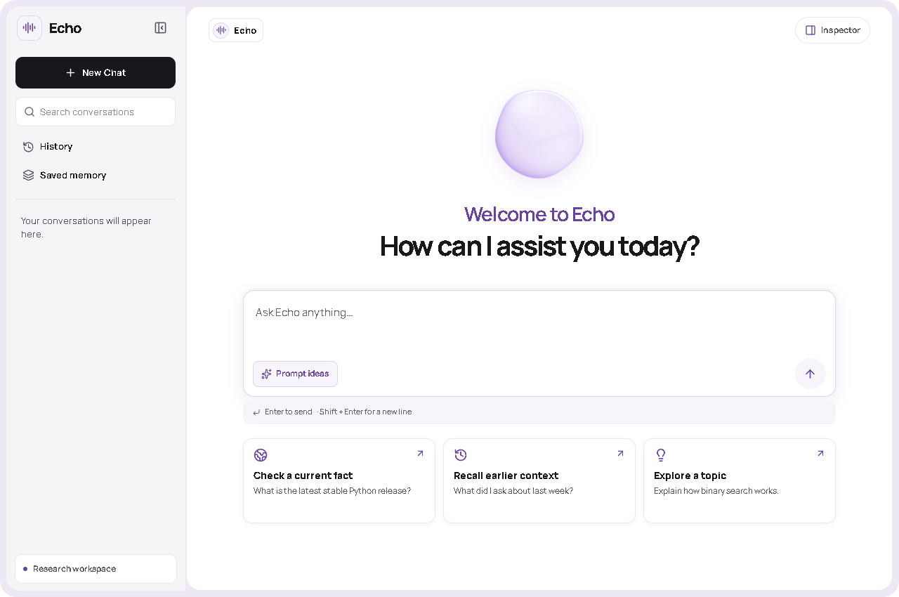
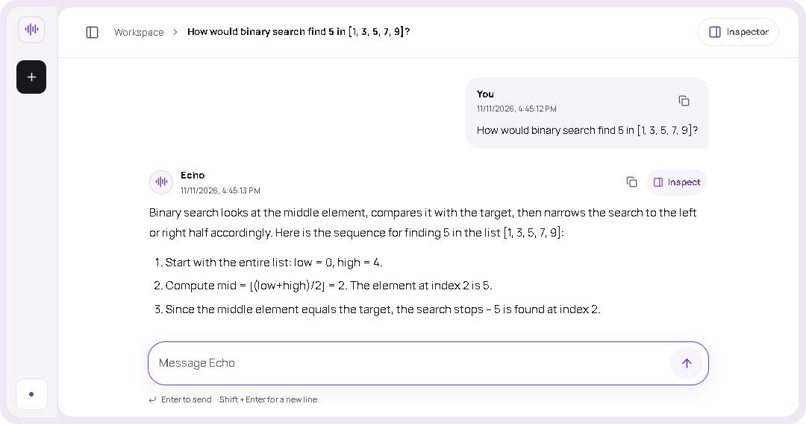
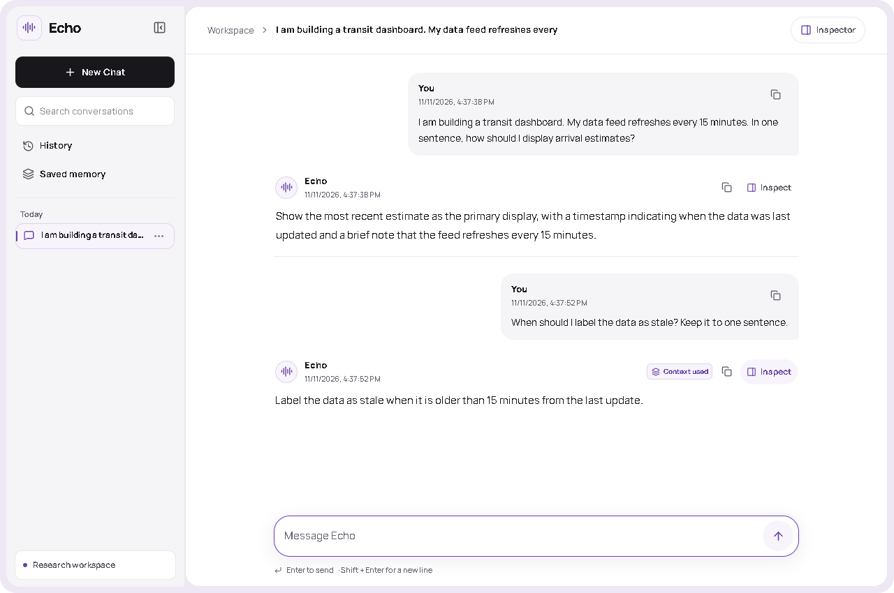
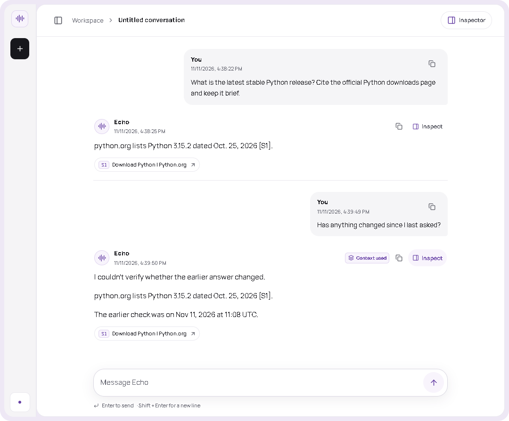
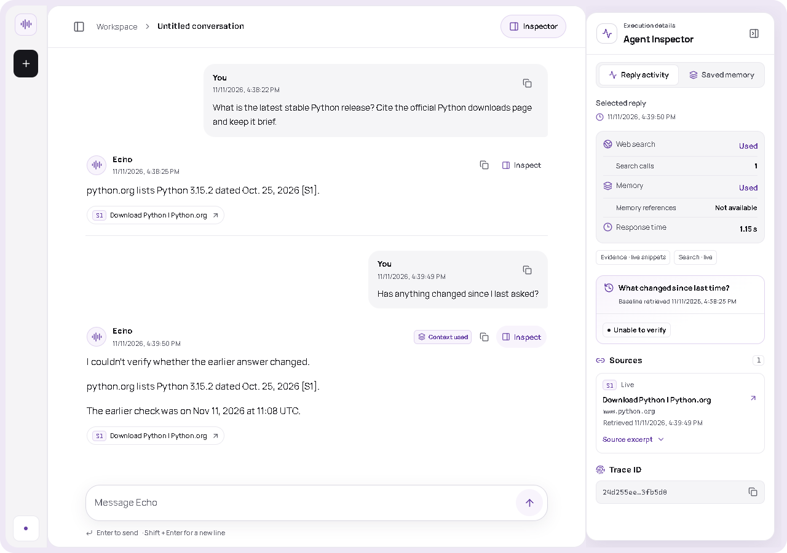

# Echo

**A time-aware AI chat agent that remembers your questions and checks what has changed.**

[Hosted preview](https://echo-time-aware-agent.vercel.app/) · [Feature walkthrough](docs/feature-walkthrough.md) · [Technical design](DESIGN.md)

## Overview

Ask a question, follow up without repeating the setup, or come back later to check whether an earlier answer still holds. Echo keeps conversation history and dated research so you can see what it checked and when.

## Key features

- **Quick replies.** Everyday questions go straight to the language model. Echo uses Tavily when a question needs current information.
- **Follow-ups that carry context.** Echo saves each turn and can use details from earlier messages in the same conversation. You can ask “When should I label the data as stale?” without restating which data feed you mean.
- **Temporal memory.** Echo records when you asked and when it retrieved evidence. On a recheck, it compares the saved result with fresh sources and flags conflicts or gaps in the evidence.
- **Grounded answers.** Citations link current claims to their sources. The supporting excerpts are available in the Agent Inspector.
- **Inspectable replies.** Open the Agent Inspector to see whether Echo used search or memory, how long the reply took, and which sources it used.

## Product tour

### Landing page

*The welcome screen offers prompts for a current fact, a memory question, or a general topic.*

### Chat in action

*Echo answers a general question about binary search directly from the model.*

### Context-aware follow-up

*Echo carries the earlier 15-minute refresh interval into the follow-up and marks the reply “Context used.”*

### Temporal comparison

*Echo rechecks the Python release, cites the latest search result, and gives the time of the earlier check. In this run it couldn’t verify a change.*

### Agent Inspector

*The Inspector shows that the recheck used search and memory, plus the earlier retrieval time, source details, and trace ID.*

## How Echo works

1. **Load context.** The Node.js API retrieves recent turns, relevant saved details, and earlier research. The browser timezone determines the date window for questions like “What did I ask on 3 November?”
2. **Route the question.** The language model answers general questions directly. Questions that need current evidence can use Tavily, Echo’s web search tool.
3. **Check the evidence.** Echo validates source excerpts, attaches citations, and compares matching claims with the earlier research when the user asks for a recheck.
4. **Save and stream.** Echo saves the new turn and any research or memory updates. The Next.js workspace receives progress and the answer over server-sent events.

~~~mermaid
flowchart LR
    B[Browser] --> N[Next.js chat workspace]
    N -->|Same-origin REST and SSE| A[Fastify on Node.js]
    A --> R[Routing and context]
    R -->|Read history, memory and snapshots| D[(PostgreSQL or local SQLite)]
    R -->|Plan search or generate answer| M[Groq or OpenAI]
    R -->|One web search tool| T[Tavily]
    T --> G[Validate excerpts and compare claims]
    M --> G
    G -->|Commit turn, memory and research| D
    G -->|Progress and saved reply| A
~~~

Groq hosts the default model. The adapter also supports OpenAI. The API uses SQLite locally and supports PostgreSQL for hosted storage. [Technical design](DESIGN.md)

## Why Echo is different

An earlier answer is a reference point you can return to. Echo keeps the evidence from the earlier check alongside what it finds on a recheck. It can report agreement, a change, or uncertainty, and you can open the Inspector to see why.

## Run locally

Use Node.js 22.18 or later. From the repository root, copy `.env.example` to `.env` and set `GROQ_API_KEY` and `TAVILY_API_KEY`. On Windows, use `Copy-Item .env.example .env`.

~~~bash
npm install
npm run dev
~~~

Open the [chat workspace](http://127.0.0.1:3000/). The command starts both Node processes and creates the local SQLite database on first run. The API serves health at [port 8000](http://127.0.0.1:8000/api/v1/health). If either port is occupied, set `ECHO_WEB_PORT` or `ECHO_API_PORT` in the shell before running the dev command.

| Variable | Where to set it | Purpose |
| --- | --- | --- |
| `ECHO_LLM_PROVIDER` | Backend | Choose `groq` or `openai`. The example selects Groq. |
| `GROQ_API_KEY`, `GROQ_MODEL` | Backend | Groq credential and optional model override. The example uses `openai/gpt-oss-20b`. |
| `OPENAI_API_KEY`, `OPENAI_MODEL` | Backend | Credential and model override when using OpenAI. |
| `TAVILY_API_KEY` | Backend | Web search credential. |
| `ECHO_DATABASE_URL` | Backend | Defaults to `sqlite:///./echo.db`. Set a PostgreSQL connection URL to use PostgreSQL. |
| `ECHO_PUBLIC_DEMO`, `ECHO_BROWSER_SECRET` | Backend | Public mode requires PostgreSQL and a signing secret of at least 32 bytes. The secret keeps anonymous browser histories separate. |
| `ECHO_FRONTEND_ORIGIN` | Backend | Exact HTTPS frontend origin for direct browser CORS access. |
| `NEXT_PUBLIC_API_BASE_URL` | Frontend | Backend origin for the Next.js rewrite. Defaults to loopback locally and is required on Vercel production builds. |

Keep provider keys and signing credentials in the backend environment. Next.js forwards REST and SSE through the frontend origin and needs only the API origin.

## Try it

1. Start a chat and send “My interview is on Friday.” Then send “Actually, my interview was moved to Monday.”
2. Start a new chat in the same browser and ask “What is my interview plan?” Open **Agent Inspector → Saved memory** to see the active plan and the superseded record when Echo extracted the correction.
3. Ask “What is the latest stable Python release? Cite python.org.” Then ask “Has anything changed since I last asked?” Inspect the recheck to see the earlier retrieval time and new evidence. The verdict depends on the sources available when you try it.

## Development checks

~~~bash
npm test
npm run lint
npm run build
npm run typecheck
~~~

## Deployment

The [Render Blueprint](render.yaml) configures the Node.js API and PostgreSQL. Set `NEXT_PUBLIC_API_BASE_URL` in the Vercel frontend project to the deployed API origin. The hosted API requires a signing secret and uses a signed, secure cookie to isolate browser histories.

## Limitations and next steps

The public demo uses anonymous browser identity, so clearing cookies or switching browsers loses access to that history. Topic lookup and model context are bounded. Routing is primarily English, and search coverage depends on Tavily. A matching excerpt establishes what a source said. Confirming a change also depends on comparable evidence being available.

Future work includes account authentication, retention controls, and stronger source ranking. [Design tradeoffs](DESIGN.md)
