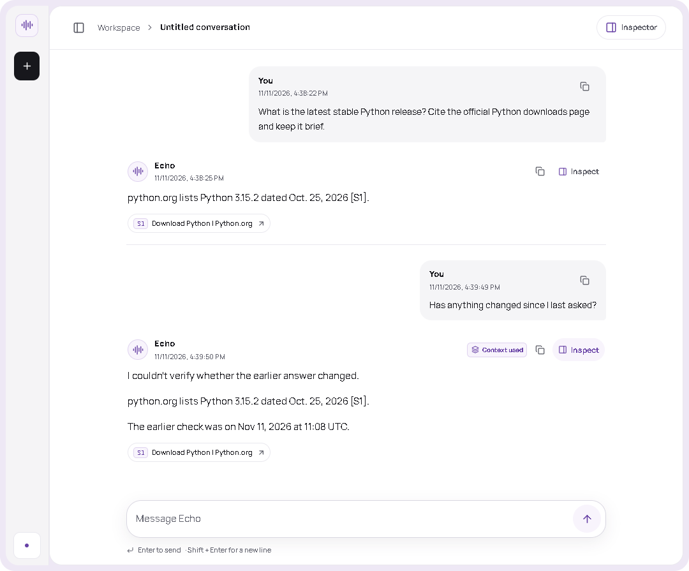
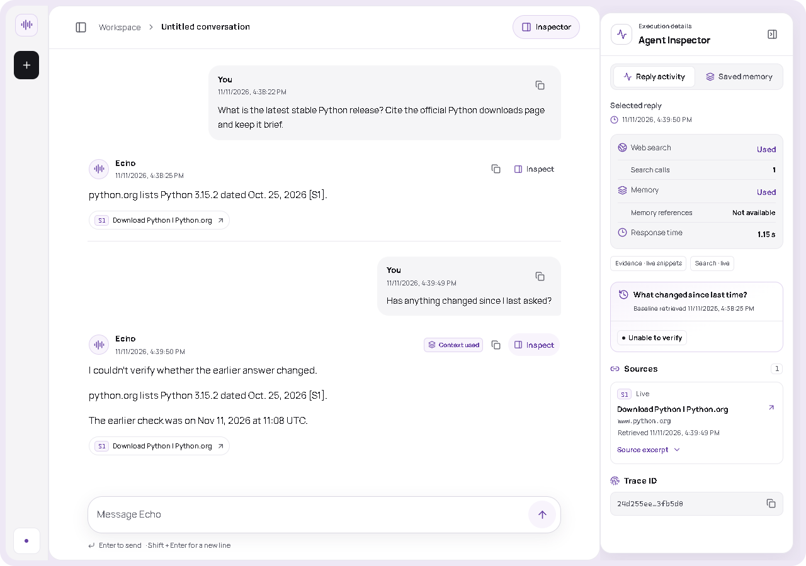

# Echo feature walkthrough

Use the [live Echo demo](https://echo-time-aware-agent.vercel.app/) in one browser. Open the Agent Inspector to see which path each answer took and what evidence it used.

~~~mermaid
flowchart LR
    A[Ask a general question] --> B[Direct answer]
    C[Ask for a current fact] --> D[Web search and cited excerpts]
    D --> E[Ask what changed in the same chat]
    E --> F[Earlier and current evidence in the Inspector]
    G[Share a plan and correct it] --> H[Open a new chat and recall the plan]
    H --> I[Active and superseded entries in Saved memory]
~~~

| What to try | What to inspect |
| --- | --- |
| “Why does rain fall?” | A direct answer. The Inspector should show no web search. |
| “Search the web for the latest stable Python release. Cite python.org.” | The source excerpts, their retrieval times, and the search activity. |
| In that chat, ask “Has anything changed since I last asked?” | The previous snapshot and current evidence. A recheck can report agreement, a change, conflict, or insufficient evidence. It depends on the sources. |
| Say “My interview is on Friday.” Then say “Actually, my interview was moved to Monday.” Start a new chat and ask “What is my interview plan?” | When the model extracts the two statements, the reply can recall Monday. **Saved memory** shows the active entry and the superseded one. |

## Live demo screenshots

Echo cites python.org for the release check. When asked what changed, it looks up the earlier check and searches again. In this run, Echo surfaced the new citation and the earlier timestamp, and reported that it couldn’t verify a change.

Open **Inspect** on the recheck to see the search and memory status, baseline retrieval time, and the **Unable to verify** verdict.

See the [README product tour](../README.md#product-tour) for the welcome screen, a direct answer, and a same-chat follow-up.
