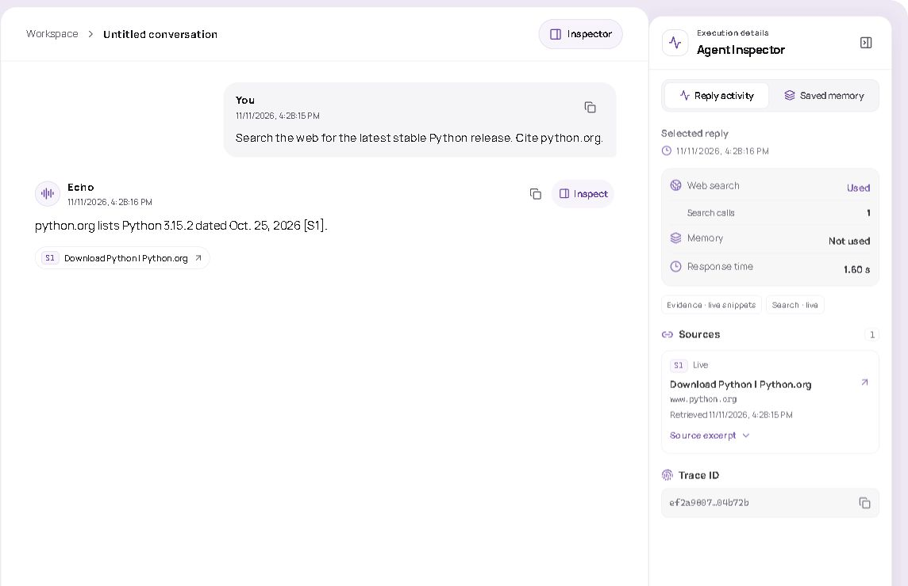
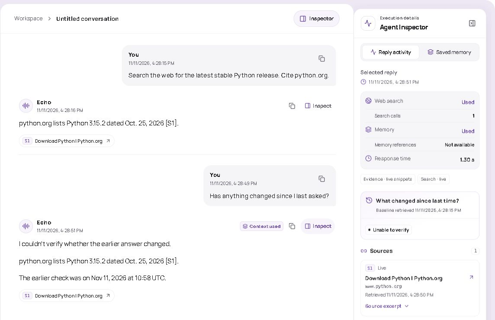

# Echo feature walkthrough

Use the [live Echo demo](https://echo-time-aware-agent.vercel.app/) in one browser. Open the Agent Inspector to see which path each answer took and what evidence it used.

~~~mermaid
flowchart LR
    A[Ask a general question] --> B[Direct answer]
    C[Ask for a current fact] --> D[Web search and cited excerpts]
    D --> E[Ask what changed in the same chat]
    E --> F[Earlier and current evidence in the Inspector]
    G[Share a plan and correct it] --> H[Open a new chat and recall the plan]
    H --> I[Active and superseded entries in Saved memory]
~~~

| What to try | What to inspect |
| --- | --- |
| “Why does rain fall?” | A direct answer. The Inspector should show no web search. |
| “Search the web for the latest stable Python release. Cite python.org.” | The source excerpts, their retrieval times, and the search activity. |
| In that chat, ask “Has anything changed since I last asked?” | The previous snapshot and current evidence. A recheck can report agreement, a change, conflict, or insufficient evidence. It depends on the sources. |
| Say “My interview is on Friday.” Then say “Actually, my interview was moved to Monday.” Start a new chat and ask “What is my interview plan?” | When the model extracts the two statements, the reply can recall Monday. **Saved memory** shows the active entry and the superseded one. |

For a repeatable conflict check, run `python -m pytest -q tests/test_api.py -k recheck` from the repository root. The fixtures cover an omitted competing source and a recheck that picks a different quote from an earlier listing. [Technical design](../design.md)

## Live demo screenshots

Echo answers a current question with a citation. The Inspector shows that it searched the web and when it retrieved the source.

On the follow-up, Echo uses the earlier check as a baseline and searches again. In this run, the Inspector shows the baseline time and an **Unable to verify** verdict.

